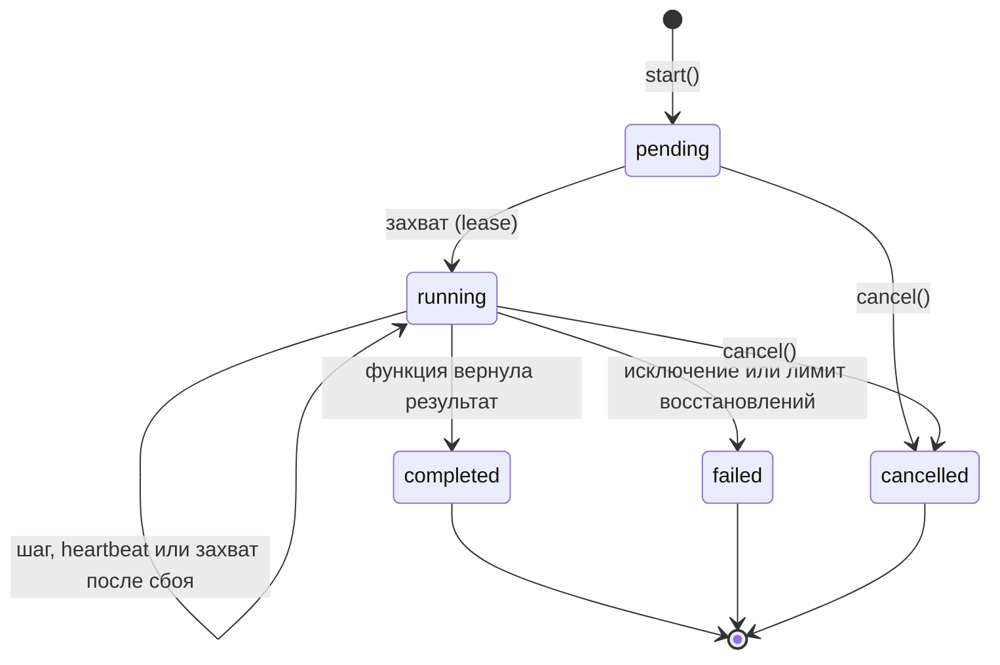
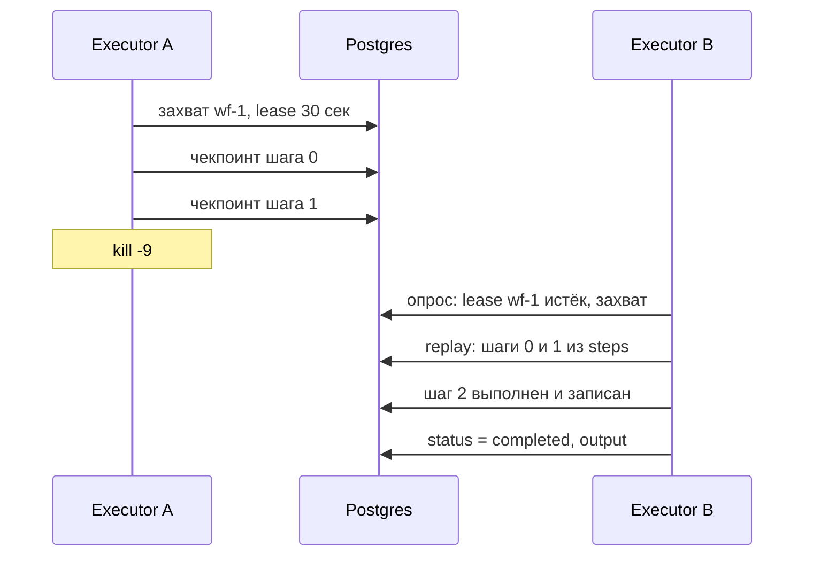

# durable-pg: библиотека durable execution на Postgres

> Техническое задание · учебный проект
> Версия ТЗ: 1.0 · Дата: 22.10.2026 · Рабочее имя: `durable-pg` · Первый потребитель: harness-engineering

Библиотека для Node.js, которая позволяет писать долгие процессы обычными async-функциями и гарантирует, что они дойдут до конца после падения процесса, перезапуска или долгого ожидания человека.

## Содержание

1. [Цель и рамки](#1-цель-и-рамки)
2. [Термины](#2-термины)
3. [Окружение и ограничения](#3-окружение-и-ограничения)
4. [Публичный API](#4-публичный-api)
5. [Модель данных](#5-модель-данных)
6. [Жизненный цикл](#6-жизненный-цикл)
7. [Гарантии](#7-гарантии)
8. [Функциональные требования](#8-функциональные-требования)
9. [Нефункциональные требования](#9-нефункциональные-требования)
10. [Ошибки](#10-ошибки)
11. [Этапы реализации](#11-этапы-реализации)
12. [Тестирование](#12-тестирование)
13. [Решения на выбор](#13-решения-на-выбор)
14. [Что почитать](#14-что-почитать)

---

## 1. Цель и рамки

Цель проекта — разобраться, как устроен durable execution, реализовав его самостоятельно. Ориентиры: DBOS (чекпоинты шагов в Postgres) и Temporal (воспроизведение истории). Готовая библиотека должна заменить DBOS в проекте harness-engineering через порт `DurableRuntime`.

### Входит в объём

- Регистрация и запуск workflow с идемпотентным `id`.
- Чекпоинт каждого шага в Postgres и воспроизведение (replay) после сбоя.
- Автоматическое восстановление незавершённых workflow при старте и в фоне.
- Аренда (lease) и heartbeat, чтобы несколько процессов не выполняли один workflow одновременно.
- Повторы шагов с экспоненциальной задержкой.
- Durable-сон (`sleep`) и ожидание сообщений (`recv`/`send`) с таймаутом.
- Отмена, статус, история шагов, хук наблюдаемости.
- Обнаружение недетерминизма и версии workflow.

### Не входит в объём

- Отдельный сервер или кластер: библиотека работает внутри процесса приложения, единственная внешняя зависимость — Postgres.
- UI и CLI (кроме простого скрипта просмотра истории, по желанию).
- Cron-расписания, очереди с приоритетами, SDK для других языков.
- Гарантия «ровно один раз» для побочных эффектов во внешних системах. Это невозможно без их участия, поэтому библиотека даёт ключи идемпотентности.

## 2. Термины

| Термин | Значение |
|---|---|
| **Workflow** | Зарегистрированная async-функция `(ctx, input) => output`. Её код должен быть детерминированным. |
| **Экземпляр (run)** | Один запуск workflow с конкретным `id` и входом. Строка в таблице `workflows`. |
| **Шаг (step)** | Недетерминированная операция внутри workflow (сеть, LLM, БД, время). Её результат сохраняется. |
| **seq** | Порядковый номер шага внутри экземпляра: 0, 1, 2… Присваивается в момент вызова. |
| **Чекпоинт** | Запись результата или ошибки шага в таблицу `steps`. |
| **Replay** | Повторный запуск функции workflow с начала, при котором уже записанные шаги возвращают сохранённый результат, не выполняясь. |
| **Executor** | Процесс, который выполняет workflow. Имеет уникальный `executorId`. |
| **Lease** | Аренда экземпляра executor-ом до момента `lease_until`. Продлевается heartbeat-ом. |
| **Recovery** | Захват экземпляров с истёкшей арендой и их replay. |
| **Topic** | Именованный канал сообщений для конкретного экземпляра (например, `approval`). |
| **Ключ идемпотентности** | Стабильный ключ `{workflowId}:{seq}`, который передаётся во внешнюю систему, чтобы повтор шага не создал дубль. |

## 3. Окружение и ограничения

- Node.js 22+, TypeScript в режиме `strict`, ESM.
- Postgres 14+. Единственная runtime-зависимость — драйвер `pg`. Можно принимать готовый `Pool` снаружи.
- Тесты: `node:test` или `vitest`, Postgres в Docker (`docker compose` или testcontainers).
- Никаких глобальных синглтонов: всё состояние живёт в экземпляре, созданном через `createDurable()`. Две независимые библиотеки в одном процессе не мешают друг другу.
- Все таблицы лежат в отдельной схеме (по умолчанию `durable`), её имя настраивается.

## 4. Публичный API

### Пример использования

```ts
import { createDurable } from "durable-pg";

const durable = createDurable({
  connectionString: process.env.DATABASE_URL,
  executorId: "worker-1",          // по умолчанию `${hostname}:${pid}`
  leaseMs: 30_000,
  heartbeatMs: 10_000,
  pollMs: 1_000,
  maxConcurrent: 50,
  onEvent: (e) => console.log(e),  // наблюдаемость
});

const refund = durable.workflow(
  "refund",
  async (ctx, input: { customerId: string; chargeId: string }) => {
    const charge = await ctx.step("load-charge", () => billing.get(input.chargeId));

    const decision = await ctx.recv<{ approved: boolean }>("approval", {
      timeoutMs: 24 * 60 * 60 * 1000,
    });
    if (!decision?.approved) return { refunded: false };

    await ctx.step(
      "issue-refund",
      (s) => billing.refund(charge.id, { idempotencyKey: s.idempotencyKey }),
      { retries: 5, backoffMs: 500 },
    );
    await ctx.sleep(60_000);
    return { refunded: true };
  },
  { version: "1" },
);

await durable.migrate();
await durable.start();                // восстановление + фоновый захват работы

const handle = await refund.start(
  { customerId: "cus_1", chargeId: "ch_2" },
  { id: "refund-ch_2" },              // повторный start с тем же id вернёт тот же экземпляр
);
await durable.send(handle.id, "approval", { approved: true }, { idempotencyKey: "ui-click-42" });
console.log(await handle.result());
await durable.shutdown();
```

### Типы

```ts
function createDurable(options: DurableOptions): Durable;

interface DurableOptions {
  connectionString?: string;
  pool?: pg.Pool;                  // либо connectionString, либо pool
  schema?: string;                 // "durable"
  executorId?: string;
  leaseMs?: number;                // 30_000
  heartbeatMs?: number;            // leaseMs / 3
  pollMs?: number;                 // 1_000
  maxConcurrent?: number;          // 50
  maxRecoveryAttempts?: number;    // 10
  onEvent?: (event: DurableEvent) => void;
  logger?: Pick<Console, "info" | "warn" | "error">;
}

interface Durable {
  workflow<I, O>(
    name: string,
    fn: (ctx: WorkflowContext, input: I) => Promise<O>,
    opts?: { version?: string },
  ): Workflow<I, O>;
  migrate(): Promise<void>;
  start(): Promise<void>;
  shutdown(opts?: { timeoutMs?: number }): Promise<void>;
  send(workflowId: string, topic: string, payload: unknown,
       opts?: { idempotencyKey?: string }): Promise<void>;
  cancel(workflowId: string): Promise<void>;
  getStatus(workflowId: string): Promise<WorkflowStatus | null>;
  list(filter?: { status?: Status; name?: string; limit?: number }): Promise<WorkflowStatus[]>;
  steps(workflowId: string): Promise<StepRecord[]>;
}

interface Workflow<I, O> {
  readonly name: string;
  start(input: I, opts?: { id?: string }): Promise<WorkflowHandle<O>>;
}

interface WorkflowHandle<O> {
  readonly id: string;
  result(opts?: { timeoutMs?: number }): Promise<O>;
  status(): Promise<WorkflowStatus>;
}

interface WorkflowContext {
  readonly workflowId: string;
  readonly signal: AbortSignal;    // срабатывает при cancel() и потере lease
  step<T>(name: string, fn: (s: StepInfo) => Promise<T>, opts?: StepOptions): Promise<T>;
  sleep(ms: number): Promise<void>;
  recv<T>(topic: string, opts?: { timeoutMs?: number }): Promise<T | null>;
  now(): Promise<number>;          // durable Date.now()
  uuid(): Promise<string>;         // durable randomUUID()
  startChild<I, O>(wf: Workflow<I, O>, input: I, opts?: { id?: string }): Promise<WorkflowHandle<O>>;
}

interface StepInfo { workflowId: string; seq: number; attempt: number; idempotencyKey: string }
interface StepOptions { retries?: number; backoffMs?: number; maxBackoffMs?: number }

type Status = "pending" | "running" | "completed" | "failed" | "cancelled";
```

## 5. Модель данных

Схема создаётся методом `migrate()`. Миграции версионируются в таблице `migrations` и применяются под advisory lock, чтобы два процесса не мигрировали одновременно.

```sql
CREATE SCHEMA IF NOT EXISTS durable;

CREATE TABLE durable.workflows (
  id                text PRIMARY KEY,
  name              text NOT NULL,
  version           text NOT NULL,
  status            text NOT NULL
                    CHECK (status IN ('pending','running','completed','failed','cancelled')),
  input             jsonb NOT NULL,
  output            jsonb,
  error             jsonb,
  executor_id       text,
  lease_until       timestamptz,
  recovery_attempts int  NOT NULL DEFAULT 0,
  parent_id         text REFERENCES durable.workflows(id),
  created_at        timestamptz NOT NULL DEFAULT now(),
  updated_at        timestamptz NOT NULL DEFAULT now()
);
CREATE INDEX ON durable.workflows (status, lease_until);

CREATE TABLE durable.steps (
  workflow_id  text NOT NULL REFERENCES durable.workflows(id) ON DELETE CASCADE,
  seq          int  NOT NULL,
  name         text NOT NULL,
  kind         text NOT NULL CHECK (kind IN ('step','sleep','recv','now','uuid','child')),
  output       jsonb,
  error        jsonb,
  attempts     int  NOT NULL DEFAULT 1,
  completed_at timestamptz NOT NULL DEFAULT now(),
  PRIMARY KEY (workflow_id, seq)
);

CREATE TABLE durable.messages (
  id              bigserial PRIMARY KEY,
  workflow_id     text NOT NULL REFERENCES durable.workflows(id) ON DELETE CASCADE,
  topic           text NOT NULL,
  payload         jsonb,
  idempotency_key text UNIQUE,
  created_at      timestamptz NOT NULL DEFAULT now(),
  consumed_at     timestamptz
);
CREATE INDEX ON durable.messages (workflow_id, topic) WHERE consumed_at IS NULL;

CREATE TABLE durable.migrations (
  version    int PRIMARY KEY,
  applied_at timestamptz NOT NULL DEFAULT now()
);
```

### Как разные операции ложатся в steps

| Операция | Записи в steps | Поведение при replay |
|---|---|---|
| `step` | 1 запись: результат или финальная ошибка после всех повторов | Вернуть `output` или бросить сохранённую ошибку |
| `sleep(ms)` | 1 запись в начале: `{ wakeAt }` | Ждать `max(0, wakeAt − now)` |
| `recv` | 2 записи: `now` (дедлайн) и `recv` (payload или `null`) | Дедлайн берётся из первой записи, payload из второй |
| `now`, `uuid` | 1 запись со значением | Вернуть сохранённое значение |
| `startChild` | 1 запись: `{ childId }` | Вернуть handle существующего дочернего экземпляра |

## 6. Жизненный цикл

Статус `running` не означает, что процесс жив. Жив он, пока не истекла `lease_until`. Workflow с истёкшей арендой захватывает любой executor с той же версией.



### Восстановление после сбоя



## 7. Гарантии

| Что | Гарантия | Почему именно так |
|---|---|---|
| Экземпляр workflow | Доходит до конечного статуса, пока жив хотя бы один executor с его версией | Recovery и lease |
| Код шага | Как минимум один раз | Процесс может упасть после `fn()`, но до записи чекпоинта |
| Результат шага, который видит workflow | Ровно один раз | `PRIMARY KEY (workflow_id, seq)` и `ON CONFLICT DO NOTHING` с перечитыванием |
| Доставка сообщения в `recv` | Ровно один раз | Пометка `consumed_at` и чекпоинт в одной транзакции |
| `send` с ключом | Идемпотентен | `UNIQUE (idempotency_key)` |
| Побочный эффект во внешней системе | Не гарантируется | Нужен ключ идемпотентности из `StepInfo` |

> **Детерминизм.** Код workflow между шагами должен при каждом replay вызывать те же шаги в том же порядке. Запрещено вне шагов: `Date.now()`, `Math.random()`, `crypto.randomUUID()`, сеть, чтение файлов и env, которые могут измениться. Для времени и id есть `ctx.now()` и `ctx.uuid()`.

## 8. Функциональные требования

### FR-01. Регистрация workflow

`durable.workflow(name, fn, { version })` регистрирует функцию в реестре экземпляра. Повторная регистрация того же имени бросает ошибку. Версия по умолчанию `"1"`.

**Готово, если:** recovery находит функцию по `name`. Если функции нет в реестре, экземпляр не трогается, в лог пишется предупреждение.

### FR-02. Идемпотентный запуск

`wf.start(input, { id })` вставляет строку со статусом `pending`. Если `id` уже существует, возвращает handle существующего экземпляра и не создаёт новый. Без `id` генерируется UUID. Если у executor-а есть свободная ёмкость, он сразу захватывает экземпляр и выполняет его локально.

**Готово, если:** 100 параллельных `start` с одним `id` дают одну строку и одно выполнение.

### FR-03. Чекпоинт шага и replay

`ctx.step(name, fn)` синхронно получает следующий `seq`. Затем ищет запись `(workflowId, seq)`: если она есть, возвращает `output` или бросает сохранённую ошибку. Если нет, выполняет `fn` и записывает результат. Результат должен сериализоваться в JSON, иначе `SerializationError`. Значение после replay должно быть равно значению после `JSON.parse(JSON.stringify(x))`, и это поведение одинаково при первом выполнении и при replay.

**Готово, если:** после `kill -9` на шаге 3 и перезапуска счётчики побочных эффектов шагов 0–2 равны 1.

### FR-04. Защита от двойного выполнения (fencing)

Каждая запись чекпоинта выполняется условно, только если `workflows.executor_id` всё ещё равен текущему executor-у. Если условие не выполнено (аренду перехватили), бросается `LeaseLostError`, срабатывает `ctx.signal`, и локальное выполнение прекращается. При конфликте `(workflow_id, seq)` берётся уже записанное значение.

**Готово, если:** в тесте с искусственной паузой executor A после истечения аренды не может записать шаг, а B доводит экземпляр до конца.

### FR-05. Recovery и фоновый захват

`durable.start()` немедленно, а затем каждые `pollMs` захватывает экземпляры в статусах `pending` и `running` с `lease_until < now()` или `NULL` и своей версией. Захват идёт через `SELECT … FOR UPDATE SKIP LOCKED` не больше свободной ёмкости. При захвате `recovery_attempts` увеличивается на 1. Если превышен `maxRecoveryAttempts`, статус становится `failed` (защита от «отравленных» экземпляров, которые роняют процесс).

**Готово, если:** два executor-а и 200 экземпляров дают 200 завершений и ни одного двойного выполнения шага.

### FR-06. Heartbeat

Каждые `heartbeatMs` executor одним запросом продлевает `lease_until` для всех своих выполняющихся экземпляров. Если продлить не удалось, срабатывает `LeaseLostError` (как в FR-04).

**Готово, если:** шаг длиной 3 × `leaseMs` не приводит к перехвату другим executor-ом.

### FR-07. Повторы шагов

`StepOptions.retries` задаёт число повторов. Задержка растёт экспоненциально: `backoffMs · 2^attempt` со случайным разбросом, не больше `maxBackoffMs`. Номер попытки передаётся в `StepInfo.attempt`. В БД пишется только финальный результат и число попыток. Ошибка сериализуется как `{ name, message, stack }`.

**Готово, если:** шаг, который падает 2 раза из 3, при `retries: 3` завершается успешно, а в `steps.attempts` записано 3.

### FR-08. Durable sleep

`ctx.sleep(ms)` записывает `wakeAt = now + ms` и ждёт в памяти. При replay ждёт только оставшееся время. Пока workflow спит, executor держит аренду через heartbeat.

**Готово, если:** процесс, убитый посреди `sleep(10s)` на 4-й секунде и сразу перезапущенный, просыпается примерно через 6 секунд.

### FR-09. Сообщения: send и recv

- `send` вставляет сообщение и делает `NOTIFY durable_messages, '{workflowId}'`. Отправка в несуществующий экземпляр — `WorkflowNotFoundError`.
- `recv` сначала записывает дедлайн (шаг `now`), затем ждёт: `LISTEN` плюс периодический опрос как подстраховка.
- Получение выполняется одной транзакцией: `UPDATE messages SET consumed_at = now()` для самого старого непрочитанного сообщения по `(workflow_id, topic)` с `FOR UPDATE SKIP LOCKED`, плюс `INSERT` в `steps`.
- По таймауту записывается `null`.

**Готово, если:** сообщение, отправленное до вызова `recv`, тоже доставляется. После `kill -9` сразу после получения сообщение не теряется и не доставляется дважды.

### FR-10. Результат и статус

`handle.result()` ждёт конечного статуса через `LISTEN durable_status` с подстраховкой опросом. Для `failed` бросает `WorkflowFailedError` с исходной ошибкой, для `cancelled` — `WorkflowCancelledError`. `getStatus`, `list` и `steps` читают данные для инспектора.

### FR-11. Отмена

`cancel(id)` ставит статус `cancelled`, если экземпляр ещё не завершён. Executor замечает это при следующем чекпоинте или heartbeat, срабатывает `ctx.signal`, и следующий вызов `ctx.*` бросает `WorkflowCancelledError`. Уже начатый шаг не прерывается принудительно, но получает `signal`.

### FR-12. Обнаружение недетерминизма

Если при replay запись с данным `seq` есть, но её `name` или `kind` отличается от текущего вызова, бросается `NonDeterminismError` с ожидаемым и фактическим значением. Экземпляр переходит в `failed`.

**Готово, если:** изменение порядка двух шагов в коде между запуском и recovery даёт понятную ошибку, а не тихо неверный результат.

### FR-13. Версии

У экземпляра сохраняется версия workflow на момент запуска. Executor захватывает только экземпляры тех версий, которые у него зарегистрированы. Старые экземпляры дорабатывает executor со старым кодом.

### FR-14. Дочерние workflow (опционально)

`ctx.startChild` запускает дочерний экземпляр с детерминированным `id` (по умолчанию `{parentId}:{seq}`) и записывает его в `steps`. Нужен для супервизора в harness: параллельные исследователи как отдельные workflow.

### FR-15. События для наблюдаемости

`onEvent` получает события `workflow.started`, `workflow.recovered`, `step.started`, `step.completed`, `step.retrying`, `step.replayed`, `workflow.waiting`, `workflow.completed`, `workflow.failed`, `workflow.cancelled`, `lease.lost`. Ошибка внутри обработчика не ломает выполнение.

### FR-16. Graceful shutdown

`shutdown()` перестаёт захватывать новую работу, ждёт текущие шаги до `timeoutMs`, затем сбрасывает `lease_until` своих экземпляров в `now()`, чтобы другой executor подхватил их сразу, и закрывает пул, если сам его создал.

## 9. Нефункциональные требования

- **Накладные расходы шага:** при первом выполнении не больше одного чтения и одной записи. При replay все записи экземпляра загружаются одним запросом в начале, а не по одному на шаг.
- **Ограничение параллелизма:** не больше `maxConcurrent` экземпляров на executor.
- **Соединения:** один выделенный клиент на `LISTEN` и общий пул для остального. Потеря `LISTEN`-соединения переподключается автоматически, а опрос продолжает работать.
- **Типизация:** тип `input` и `output` выводится из функции workflow.
- **Тестируемость:** время и генератор id внедряются через опции (`clock`, `idGenerator`), чтобы тесты были детерминированными.
- **Документация:** README с примерами и разделом «правила детерминизма».

## 10. Ошибки

| Класс | Когда |
|---|---|
| `DurableError` | Базовый класс для всех ошибок библиотеки |
| `SerializationError` | Вход, выход или результат шага не сериализуются в JSON |
| `StepFailedError` | Шаг исчерпал повторы. В `cause` лежит исходная ошибка |
| `NonDeterminismError` | При replay вызван не тот шаг (FR-12) |
| `LeaseLostError` | Аренду перехватил другой executor (FR-04, FR-06) |
| `WorkflowCancelledError` | Экземпляр отменён |
| `WorkflowFailedError` | Из `handle.result()` для экземпляра в статусе `failed` |
| `WorkflowNotFoundError` | `send`, `cancel` или `getStatus` с неизвестным id |
| `DuplicateWorkflowError` | Повторная регистрация имени |

## 11. Этапы реализации

Каждый этап заканчивается работающей библиотекой и тестом, который демонстрирует новую гарантию. Этапы стоит делать по порядку: каждый следующий опирается на предыдущий.

### M1. Скелет и миграции

Проект, `createDurable`, `migrate()` с advisory lock, Docker Compose с Postgres, тестовый хелпер «чистая схема на тест».

*Готово:* `migrate()` дважды подряд и из двух процессов не падает.

### M2. Workflow и шаги в одном процессе

FR-01, FR-02, FR-03 без recovery: `start`, `step`, `result`, сериализация, загрузка истории одним запросом.

*Готово:* ручной тест с `kill -9` и ручным повторным запуском показывает, что шаги не повторяются.

### M3. Recovery, lease и fencing

FR-04, FR-05, FR-06, FR-16. Это центральный этап: появляются фоновый цикл, аренда и условная запись.

*Готово:* автоматический crash-тест и тест с двумя executor-ами проходят.

### M4. Повторы и ошибки

FR-07, иерархия ошибок, сохранение ошибки шага и её повторный выброс при replay.

*Готово:* ошибка, записанная до сбоя, после recovery бросается так же.

### M5. Sleep и детерминированные помощники

FR-08, `ctx.now()`, `ctx.uuid()`.

*Готово:* тест сна с перезапуском посередине.

### M6. Сообщения

FR-09, FR-10: `LISTEN/NOTIFY`, атомарное получение, таймауты, ожидание результата.

*Готово:* сценарий одобрения из урока 7 (ожидание, рестарт, `send`, продолжение).

### M7. Отмена и наблюдаемость

FR-11, FR-15, `list` и `steps` для инспектора.

*Готово:* события видны в консоли, `cancel` останавливает долгий workflow.

### M8. Недетерминизм и версии

FR-12, FR-13, `maxRecoveryAttempts`.

*Готово:* перестановка шагов в коде даёт `NonDeterminismError`.

### M9. Продвинутое (по желанию)

- FR-14, дочерние workflow.
- **Транзакционные шаги:** `ctx.transaction(name, (tx) => …)`, где запись в ту же БД и чекпоинт идут одной транзакцией. Это даёт «ровно один раз» для собственных таблиц, как в DBOS.
- **Настоящая приостановка:** статус `waiting` и колонка `wake_at`. Экземпляр выгружается из памяти и освобождает аренду, а поднимается при `send` или по таймеру.
- Очереди с ограничением параллелизма по имени workflow.

### M10. Интеграция в harness

Адаптер `PgDurableRuntime` за портом `DurableRuntime` в DDD-версии harness. Запуск агента и супервизора на своей библиотеке вместо DBOS.

*Готово:* демо из уроков 2, 6 и 7 работают с `kill -9` посередине.

## 12. Тестирование

### Обязательные виды тестов

- **Модульные:** счётчик `seq`, сериализация, расчёт задержек, сопоставление записей при replay.
- **Интеграционные с Postgres:** каждое требование FR со своим критерием «Готово, если».
- **Crash-тесты:** workflow запускается в дочернем процессе (`child_process.fork`). Хук `CRASH_AT_STEP=n` вызывает `process.kill(process.pid, "SIGKILL")` до или после записи чекпоинта шага `n`. Затем запускается новый процесс и проверяется результат.
- **Счётчик побочных эффектов:** шаги в тестах пишут в отдельную таблицу `side_effects`. Так проверяется «как минимум один раз» и отсутствие лишних повторов.
- **Конкурентные:** 2–4 executor-а в разных процессах, сотни экземпляров, после чего проверяется, что каждый шаг каждого экземпляра записан ровно один раз.

### Точки внедрения сбоев

```ts
createDurable({
  ...,
  testHooks: {
    beforeCheckpoint: (wfId, seq) => { /* можно убить процесс */ },
    afterCheckpoint:  (wfId, seq) => { /* можно убить процесс */ },
    beforeHeartbeat:  () => { /* можно «заморозить» executor */ },
  },
});
```

## 13. Решения на выбор

Места, где у реальных систем разные ответы. ТЗ предлагает вариант по умолчанию, но разобраться в альтернативе и есть часть обучения.

| Вопрос | По умолчанию | Альтернатива |
|---|---|---|
| Идентификация шага | Автоматический `seq` плюс `name` для проверки (как в DBOS) | Только явные уникальные имена: проще отлаживать, но легко получить коллизию в цикле |
| Модель выполнения | Чекпоинты шагов, функция живёт в памяти | Журнал событий и полный replay (как в Temporal) |
| Долгое ожидание | Держать в памяти и продлевать аренду | Выгружать экземпляр и будить по `wake_at` (M9) |
| Уведомления | `LISTEN/NOTIFY` плюс опрос | Только опрос: проще, но с задержкой |
| Сериализация | JSON | superjson или свой кодек для `Date`, `Map`, `BigInt` |
| Параллельные шаги | Разрешены, `seq` присваивается синхронно в момент вызова | Запретить и требовать явный `ctx.parallel()` |

## 14. Что почитать

- [DBOS](https://docs.dbos.dev): ближайший аналог, тот же подход с чекпоинтами в Postgres. Стоит разобрать, как устроены их системные таблицы.
- [Temporal](https://docs.temporal.io): модель с журналом событий и replay, раздел про детерминизм и версии.
- [Restate](https://docs.restate.dev): журнал выполнения и durable promises.
- [Inngest](https://www.inngest.com/docs): шаги как отдельные HTTP-вызовы, мемоизация шагов.
- Документация Postgres: `SELECT … FOR UPDATE SKIP LOCKED`, `LISTEN/NOTIFY`, advisory locks.
- Урок 2 (Durable Execution) и урок 7 (Human-in-the-Loop) в репозитории harness-engineering: живые примеры того, что должна уметь библиотека.

---

*Учебное ТЗ. Рабочее имя `durable-pg` можно заменить. Требования помечены как FR-xx, чтобы ссылаться на них в коммитах и тестах.*
